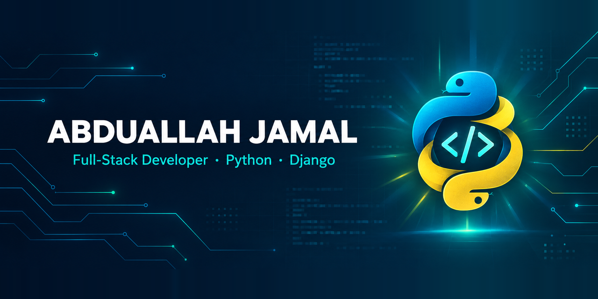

<!-- ============ BANNER ============ -->
<p align="center">
  
</p>

<h1 align="center">Hi, I'm Abduallah Jamal 👋</h1>

<p align="center">
  <b>Full-Stack Developer</b> · Python · Django · Building clean, practical web apps & developer tools
  <br />
  📍 Cairo, Egypt
</p>

<p align="center">
  <a href="https://github.com/abduallahJamal">
    
  </a>
  
  
</p>

---

<div align="right" dir="rtl">

## نبذة سريعة 🇪🇬

<p dir="rtl" align="right">
مطوّر <b>Full-Stack</b> من القاهرة، بأركّز على بناء تطبيقات ويب عملية وأدوات مطوّرين بـ <b>Python / Django</b> في الخلفية، وواجهات نظيفة وسريعة في الأمام.<br />
بحب الكود البسيط اللي بيتقرأ، والمشاريع اللي بتحل مشكلة حقيقية — والأهم إنها تخلّص صح.
</p>

</div>

---

## 🧭 About Me

```python
class Developer:
    def __init__(self):
        self.name       = "Abduallah Jamal"
        self.role       = "Full-Stack Developer"
        self.location   = "Cairo, Egypt"
        self.main_stack = ["Python", "Django", "PostgreSQL", "JavaScript"]
        self.focus      = ["Clean architecture", "REST APIs", "Developer & AI Tooling"]
        self.learning   = ["Docker", "CI/CD", "Cloud deployment"]
        self.open_to    = ["Collaboration", "Freelance", "Open Source"]

    def current_goal(self):
        return "Ship software that is simple, tested, and useful."
```

---

## 🛠️ Tech Stack

**Languages**

<p>
  
  
  
  
</p>

**Frameworks & Libraries**

<p>
  
  
  
  
</p>

**Databases & Tools**

<p>
  
  
  
  
  
  
  
  
</p>

---

## 🚀 Featured Projects

<table>
  <tr>
    <td width="100%" valign="top">
      <h3>🗡️ <a href="https://github.com/abduallahJamal/opencode-design-skills">opencode-design-skills</a></h3>
      <p>
        Three professional Agent Skills (<code>sword</code>, <code>spdf</code>, <code>shtml</code>) for <b>OpenCode</b>, <b>Claude Code</b>, and <b>Codex CLI</b> that turn raw agent output into executive-grade Word (<code>.docx</code>), PDF, and HTML documents — with first-class <b>Arabic RTL</b> support and automated CI validation.
      </p>
      <p>
        
        
        
        
        
        
      </p>
      <p>
        <a href="https://github.com/abduallahJamal/opencode-design-skills"><b>View Repository →</b></a>
        &nbsp;·&nbsp;
        <a href="https://github.com/abduallahJamal/opencode-design-skills/blob/main/README.ar.md"><b>التوثيق بالعربية →</b></a>
      </p>
    </td>
    <!-- Add a second project card side-by-side when ready (change both td widths to 50%):
    <td width="50%" valign="top">
      <h3>📦 <a href="https://github.com/abduallahJamal/REPO_NAME">Project Title</a></h3>
      <p>Short two-line description: problem solved, architecture, and key highlight.</p>
      <p>
        
        
        
      </p>
      <p><a href="https://github.com/abduallahJamal/REPO_NAME"><b>View Repository →</b></a></p>
    </td>
    -->
  </tr>
</table>

---

## 📊 GitHub Stats

<p align="center">
  
  
</p>

<p align="center">
  
</p>

<p align="center">
  
</p>

---

## 📫 Let's Connect

<p>
  <a href="https://github.com/abduallahJamal"></a>
  <!-- Add when ready:
  <a href="https://linkedin.com/in/YOUR-HANDLE"></a>
  <a href="mailto:you@example.com"></a>
  -->
</p>

<p align="center" dir="rtl">
  <i>«الكود النضيف مش رفاهية — هو أسرع طريق للتطوير.»</i>
</p>

<p align="center">
  
</p>
